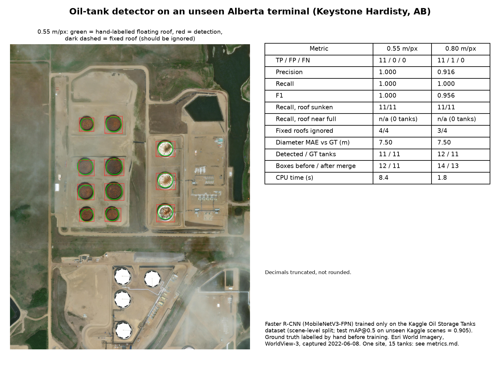

# Oil Tank Detection

[](https://github.com/lecfranzff/Oil-Tank-Detection/actions/workflows/tests.yml)

Detecting external floating-roof oil storage tanks in satellite imagery, and testing
whether a model trained on public data transfers to a real terminal it has never seen.



## Problem formulation

**Why floating-roof tanks.** Crude oil is commonly stored in tanks whose roof floats on
the liquid. Seen from above, the roof sits below the rim and the rim casts a crescent
shadow onto it; the lower the roof, the larger that inner shadow. Finding these tanks is
the first step toward estimating how much oil a terminal holds from imagery alone.

**Task.** Single-class object detection: given an RGB satellite image, output a bounding
box for every *external floating-roof* tank. Fixed-roof and domed tanks are **not**
targets and should be ignored, even though they are also round storage tanks.

**Question.** Can a detector trained only on a public dataset (Google Earth imagery of
100 refinery and terminal scenes, 36 in the US and none in Canada) find and count the
floating-roof tanks at an unseen Alberta terminal in a different imagery source, and does it:

| Hypothesis | Tested here? |
|---|---|
| H1: detects floating roofs whose roof sits visibly below the rim | yes: 11 tanks |
| H2: ignores fixed-roof / domed tanks | yes: 4 tanks |
| H3: may miss floating roofs that are nearly full (roof near the rim) | **no**: 0 such tanks in the image |

**What makes it hard (domain shift).** Different continent and climate, a different
imagery provider (Esri / Maxar WorldView-3 instead of Google Earth), a training
resolution that is not published, and tanks at Hardisty (55–70 m) that are larger in pixels than most training
tanks, so a single tank can be split into several boxes.

**Evaluation design.**
- Ground truth for the test site was labelled by hand **before the model was trained**
  (centre, rim diameter, roof type per tank), so it could not be tuned to the output.
- A detection matches a tank if its centre lies within half the tank's radius, one-to-one.
- Reported: TP/FP/FN, precision, recall, F1, recall per roof condition, how many fixed-roof
  tanks were correctly ignored, diameter error, count error, CPU runtime.
- Numbers are reported as computed (decimals truncated, never rounded up).

## Dataset

**Training data: [Kaggle Oil Storage Tanks](https://www.kaggle.com/datasets/towardsentropy/oil-storage-tanks)**
(`towardsentropy/oil-storage-tanks`, licence listed as unknown). Full description, label quirks
and the box-size figure: [docs/dataset.md](docs/dataset.md).

| Property | Value |
|---|---|
| Source scenes | 100 Google Earth scenes, 4800 × 4800 px, refinery and terminal sites in 30 countries (36 US, 7 Saudi Arabia, 6 India, 6 Japan, …; none in Canada) |
| Patches | 10,000 overlapping 512 × 512 px patches (100 per scene, named `scene_row_col.jpg`) |
| Patches containing tanks | 1,595 |
| Labelled boxes | 5,820, one class: "Floating Head Tank" (fixed-roof tanks are not labelled) |
| Box side (px) | median 63.0, 75th percentile 85.6, max 186.5 |
| Resolution | not published; measured at 0.72 m/px for the 95 scenes taken from 3000 m eye altitude and 0.48 m/px for the 5 taken from 2000 m ([how](docs/dataset.md#resolution)) |

**Split by scene, not by patch.** Patches from the same scene overlap, so a random patch
split puts near-duplicates in both train and test and inflates the score. Scenes are
split 70 / 15 / 15 with a fixed seed ([data/splits.json](data/splits.json)); a test
checks that no scene appears in two splits. In train only, 3 of every 4 tank-free patches
are dropped to save compute; validation and test keep every patch.

| Split | Scenes | Patches | With tanks | Boxes |
|---|---|---|---|---|
| train | 70 | 2,567 | 1,153 | 4,246 |
| val | 15 | 1,500 | 231 | 762 |
| test | 15 | 1,500 | 211 | 812 |

**Test site: Keystone Hardisty terminal, Hardisty, Alberta.** Located from TC Energy's
published legal land description (NW-29 / SW-32-042-09-W4) and cross-checked against the
published Phase C tank sizes (3 × 55.17 m, 3 × 65.23 m, 2 × 69.80 m). Esri World Imagery,
WorldView-3, captured 2022-06-08; 1.147 km² area of interest, 1,834.5 km from the nearest
training scene. Resampled from 0.36 m/px to 0.55 and 0.80 m/px; 0.80 m/px is the closer to the training scale. 15 scored tanks:
11 floating-roof, 4 fixed-roof.

## Results

**On held-out Kaggle scenes:** mAP@0.5 = 0.9059 (precision 0.7718, recall 0.9039 at
confidence 0.5).

**At Hardisty:**

| | 0.55 m/px | 0.80 m/px |
|---|---|---|
| Floating-roof tanks found | 11/11 | 11/11 |
| False positives | 0 | 1 |
| Fixed-roof tanks correctly ignored | 4/4 | 3/4 |
| Diameter error (box vs rim, mean) | +7.50 m | +7.50 m |
| CPU time for the whole area | 8.4 s | 1.8 s |

Full tables, per-tank results and limitations: [metrics.md](results/hardisty/metrics.md).
Every detection can be checked by eye: annotated image at
[0.55 m/px](docs/figures/annotated.jpg) and [0.80 m/px](docs/figures/annotated_080.jpg),
and a [per-tank crop sheet](docs/figures/crop_sheet.jpg) (ground truth green, detections
red). The hand-labelled [ground truth](results/hardisty/ground_truth.csv) and its
[SHA-256](results/hardisty/ground_truth.sha256) were saved before training;
[detections.csv](results/hardisty/detections.csv) has every box with longitude/latitude.
In short, this is one site, one image date and 15 tanks. It shows the model transfers to
this terminal; it is not an accuracy estimate for Alberta as a whole. Boxes include each
tank's wall and shadow, so they read larger than the rim. Hypothesis H3 is untested.

## Method

1. **Model**: Faster R-CNN with a COCO-pretrained MobileNetV3-Large FPN backbone, head
   replaced for two classes (background, tank), inputs kept at native 512 px. Trained
   10 epochs (SGD, lr 0.01, batch 4, random flips) on a Kaggle T4 GPU; best epoch chosen
   by validation AP@0.5.
   Since then the training code clips boxes to the patch and skips any step whose loss
   is NaN; the reported model was trained before that change ([details](results/hardisty/metrics.md#limitations-and-notes)).
2. **Large-image inference**: 512 px tiles with 30% overlap (more than the largest tank),
   one global NMS, then a merge pass that joins fragments of one tank (boxes whose centres
   are closer than half the larger box's side).
3. **Georeferencing**: web-mercator GeoTIFFs; ground resolution = mercator resolution ×
   cos(latitude); detections exported with longitude/latitude.

## How to run

```bash
pip install -r requirements.txt --extra-index-url https://download.pytorch.org/whl/cpu
kaggle datasets download -d towardsentropy/oil-storage-tanks -p data/raw --unzip
python scripts/prepare_data.py                       # label stats + scene split
python scripts/overfit_check.py                      # optional: training loop sanity check on CPU
python scripts/build_kaggle_job.py --user <kaggle-username>
kaggle kernels push -p scratch/kaggle_train          # train on a Kaggle GPU
kaggle kernels output <kaggle-username>/oil-tank-detector-train -p checkpoints   # best.pth, results.json
PYTHONPATH=src python -m oiltank.fetch_esri --west -111.2790 --south 52.6490 \
       --east -111.2650 --north 52.6600 --zoom 18 --out data/hardisty/khtt_z18.tif
python scripts/resample_hardisty.py                  # 0.36 m/px -> 0.55 and 0.80 m/px
python scripts/run_detection.py                      # detections at 0.55 and 0.80 m/px
python scripts/score.py && python scripts/write_metrics.py
python scripts/make_figures.py
python scripts/plot_box_sizes.py                     # training box sizes vs Hardisty tanks
python scripts/measure_training_gsd.py               # optional, ~20 min: training-data resolution
python -m pytest
```

Model weights and imagery are not included in the repository.

## Repository layout

```
src/oiltank/       dataset and split, model, training loop, tiled detection, metrics, geo, imagery fetch
scripts/           one script per stage (data prep, training job, detection, scoring, figures,
                   dataset checks); make_gt_sheet.py and measure_tanks.py were the labelling aids
tests/             split leakage, AP and IoU, merge pass, geo round-trip, checkpoint reload,
                   labels unchanged by flips, NaN steps skipped
docs/dataset.md    training data: files, labels, box sizes, scenes, split, resolution
docs/figures/      summary figure, annotated images at both resolutions, per-tank crop sheet,
                   training box-size histogram
results/hardisty/  test-site ground truth (with hash), detections before/after merge, metrics
```

## Future work

- Estimate fill level from the rim shadow on each floating roof (inner vs outer shadow, S_in / S_out).
- Find a site or image date with nearly full roofs to test H3.
- Extend from one terminal to the other Hardisty terminals and other Alberta hubs (work in progress).

Imagery © Esri, Maxar/Vantor, Earthstar Geographics.
