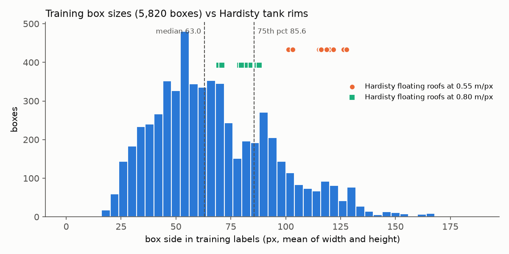

# Training data: Kaggle Oil Storage Tanks

[towardsentropy/oil-storage-tanks](https://www.kaggle.com/datasets/towardsentropy/oil-storage-tanks),
licence listed as unknown. Not redistributed here; `scripts/prepare_data.py` reads it from
`data/raw/Oil Tanks/`.

## What is in it

| File | Contents |
|---|---|
| `image_patches/` | 10,000 RGB JPEGs, 512 × 512 px, named `scene_row_col.jpg` |
| `labels_coco.json` | COCO-style: `images`, `categories`, `annotations`; each annotation has only `image_id`, `category_id`, `bbox` = `[x_min, y_min, width, height]` in px |
| `large_image_data.csv` | one row per scene: file name, Google Earth eye altitude (m), centre latitude/longitude (degrees-minutes-seconds), place name |

Each of the 100 scenes is a 4800 × 4800 px Google Earth capture cut into a 10 × 10 grid of
512 px patches. Neighbouring patches overlap: matching pixels between `01_0_0.jpg` and
`01_0_1.jpg` puts the next patch about 475 px to the right, so about 37 px are shared.

## Labels

| Property | Value |
|---|---|
| Class | one: "Floating Head Tank" (external floating roof). Fixed-roof tanks are present in the images but not labelled |
| Boxes | 5,820 on 1,595 patches (up to 34 on one patch); 8,405 patches have none |
| Box side, mean of width and height (px) | min 16.0, median 63.0, 75th percentile 85.6, max 186.5 |
| Degenerate boxes (width or height < 1 px) | 0 |
| Boxes extending past the patch edge | 331 (coordinates below 0 or above 512) |
| Boxes touching or crossing the patch edge | 1,209 |
| Width / height ratio | 5th percentile 0.43, median 1.00, 95th percentile 2.09 |

Three things to know when using these labels:

- **Boxes are per patch, not per tank.** A tank in the overlap between two patches is
  labelled in both, so 5,820 is not a count of physical tanks.
- **Edge tanks are cut.** A tank on the patch border gets a box for the visible part only,
  which is why some boxes are far from square. 331 boxes also run past the image border;
  the training code keeps them as given.
- **Boxes include wall and shadow.** The labelled box covers the whole visible tank,
  shadow included, which is larger than the rim diameter.

At 0.55 m/px the Hardisty floating roofs are 101.3–127.8 px across, larger than 88% of
training boxes (only 11.9% are at least 101.3 px). At 0.80 m/px they are 69.6–87.9 px,
inside the bulk of the distribution (39.0% of training boxes are at least 69.6 px).
Rim diameters are from the hand-labelled ground truth; the figure is made by
`scripts/plot_box_sizes.py`.

## Where the scenes are

100 scenes at refinery and terminal sites in 30 countries: 36 in the United States
(Texas 17, Louisiana 6, California 5, Oklahoma 3, Pennsylvania 3, Mississippi 1,
Delaware 1), 7 in Saudi Arabia, 6 in India, 6 in Japan and the rest spread over 26 more
countries. None is in Canada; the nearest scene to Hardisty is 1,834.5 km away.

## Split

Scenes, not patches, are split 70 / 15 / 15 with seed 0 (`data/splits.json`), because
overlapping patches from one scene would otherwise appear on both sides of the split. In
the training split only, a fixed 1 in 4 of tank-free patches is kept.

| Split | Scenes | Patches | With tanks | Boxes |
|---|---|---|---|---|
| train | 70 | 2,567 | 1,153 | 4,246 |
| val | 15 | 1,500 | 231 | 762 |
| test | 15 | 1,500 | 211 | 812 |

## Resolution

Not published by the dataset. `large_image_data.csv` records the Google Earth eye altitude
of each capture: 3000 m for 95 scenes and 2000 m for 5 (scenes 13, 16, 18, 28, 36), so
the scenes are not all at one resolution.
